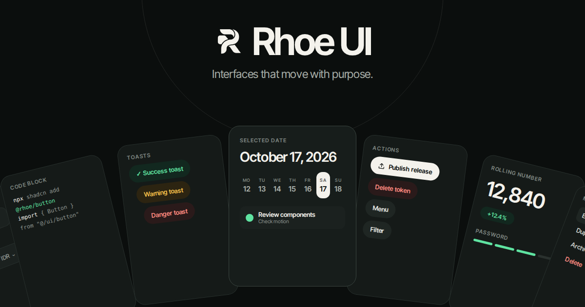

<p align="center">
  <a href="https://rhoe.syadah.my.id">
    
  </a>
</p>

<p align="center">
  <a href="./LICENSE"></a>
  <a href="https://rhoe.syadah.my.id/docs/installation"></a>
  
  
  
</p>

<p align="center">
  <a href="https://rhoe.syadah.my.id/docs"><b>Docs</b></a>
  &nbsp;·&nbsp;
  <a href="https://rhoe.syadah.my.id/components"><b>Components</b></a>
  &nbsp;·&nbsp;
  <a href="#install"><b>Install</b></a>
  &nbsp;·&nbsp;
  <a href="https://rhoe.syadah.my.id/blocks"><b>Blocks</b></a>
</p>

---

Rhoe UI is a library of React components with motion built in. Every item is plain source code you own — no runtime package to keep in sync. Install anything with the shadcn CLI or copy the files by hand. Works with Tailwind CSS v4 projects built with Next.js or Vite.

This repository is the source of truth for the **free, open source** part: **43 components and 3 blocks**, plus the design and motion tokens they share. Every component has a live preview at [rhoe.syadah.my.id](https://rhoe.syadah.my.id).

---

Rhoe UI adalah library komponen React dengan animasi bawaan. Setiap item adalah source code murni yang langsung kamu miliki — tidak ada runtime package yang perlu dijaga sinkronnya. Install apapun dengan shadcn CLI atau salin filenya secara manual. Mendukung project Tailwind CSS v4 yang menggunakan Next.js atau Vite.

Repository ini berisi bagian yang **gratis dan open source**: **43 komponen dan 3 blocks**, beserta design token dan motion token yang digunakan bersama. Setiap komponen memiliki live preview di [rhoe.syadah.my.id](https://rhoe.syadah.my.id).

---

## Contents

- [Local preview / Preview lokal](#local-preview--preview-lokal)
- [Install](#install)
  - [Requirements / Persyaratan](#requirements--persyaratan)
  - [With the shadcn CLI](#with-the-shadcn-cli)
  - [Copy and paste](#copy-and-paste)
- [Usage / Penggunaan](#usage--penggunaan)
- [Theming / Kustomisasi](#theming--kustomisasi)
- [Components / Komponen](#components--komponen)
- [Blocks](#blocks)
- [Repository Layout](#repository-layout)
- [Contributing / Kontribusi](#contributing--kontribusi)
- [License](#license)

---

## Local preview / Preview lokal

Use Node.js 24 LTS and the package manager pinned in `package.json`.

```sh
pnpm install --frozen-lockfile
pnpm dev
```

Open the local URL printed in the terminal, then visit `/components` or `/blocks`.
Next.js defaults to port 3000. To choose another port, use `pnpm dev --port 3002`
or `PORT=3002 pnpm dev`; the repository does not pin a port. If you change the
origin, set `NEXT_PUBLIC_SITE_URL` in `.env.local` to match it for metadata and
registry links (see `.env.example`).
The preview uses the same sidebar, themes, variant tabs, canvas, and examples as
Rhoe's website. It imports `registry/` directly: edit a component and see the
change immediately, without rebuilding registry JSON on every edit.

Jalankan perintah di atas untuk mencoba perubahan di browser lokal. Kerjakan
komponen dan block Free di repo ini; source Pro tidak ada di sini. Tidak perlu
akses ke repo website private. Halaman utama lokal membuka katalog Components.

Examples live in `app/(catalog)/components/previews/` and
`app/(catalog)/blocks/previews/`; API documentation lives in the adjacent catalog
JSON files. No analytics is included in the contributor preview.

Before a pull request:

```sh
pnpm build
pnpm registry:check
pnpm typecheck
pnpm lint
```

The build regenerates `public/r` and builds the preview website. Consumers using
shadcn receive only the source files declared in each registry item, not the
preview website. `pnpm registry:build` remains available for registry-only builds.

Free updates reach the production website when the maintainer imports an approved
commit and deploys. Merging here does not automatically deploy production.

---

## Install

### Requirements / Persyaratan

- **React 19** with TypeScript
- **Next.js** (App Router) or **Vite**
- **Tailwind CSS v4**
- **[motion](https://www.npmjs.com/package/motion)** for animation. Some items also use [lucide-react](https://lucide.dev); the CLI installs whatever an item needs.
- The `@/*` import alias (Next.js and shadcn set it up by default)

Rhoe UI is Tailwind-first. Components use Tailwind utilities, while shared design and motion tokens are provided through CSS variables.

---

- **React 19** dengan TypeScript
- **Next.js** (App Router) atau **Vite**
- **Tailwind CSS v4**
- **[motion](https://www.npmjs.com/package/motion)** untuk animasi. Beberapa item juga menggunakan [lucide-react](https://lucide.dev); CLI akan menginstal semua yang dibutuhkan secara otomatis.
- Import alias `@/*` (sudah diatur otomatis oleh Next.js dan shadcn)

Rhoe UI menggunakan pendekatan Tailwind-first. Komponen memakai utility Tailwind, sementara design token dan motion token bersama tersedia melalui CSS variables.

### With the shadcn CLI

Register the `@rhoe` namespace once in `components.json`:

```json
{
  "registries": {
    "@rhoe": "https://rhoe.syadah.my.id/r/{name}.json"
  }
}
```

Then add items by name. Local dependencies come along automatically:

```bash
npx shadcn@latest add @rhoe/button
npx shadcn@latest add @rhoe/dialog @rhoe/input
```

Install the design tokens once per app:

```bash
npx shadcn@latest add @rhoe/foundation
```

Then import them at the root of your app:

```tsx
// app/layout.tsx (Next.js) or src/main.tsx (Vite)
import "@/components/rhoe/foundation.css";
```

Every item also installs from its full URL, without touching `components.json`:

```bash
npx shadcn@latest add https://rhoe.syadah.my.id/r/button.json
```

### Copy and paste

1. Install the shared packages: `npm install motion lucide-react`
2. Copy `registry/components/foundation.css` and `registry/components/lib/motion-tokens.ts` into the same paths under your `@/` root, and import the CSS once at the root
3. Copy the item's folder from `registry/components/<name>/` or `registry/blocks/<name>/`, keeping the path

Each page on [rhoe.syadah.my.id](https://rhoe.syadah.my.id) has a **Manual** tab with the exact files listed.

---

## Usage / Penggunaan

The CLI puts every file in a `rhoe/` folder under the `components` alias, for example `components/rhoe/button/button.tsx`. Use them like any local component:

CLI akan menempatkan setiap file di folder `rhoe/` di bawah alias `components`, contohnya `components/rhoe/button/button.tsx`. Gunakan seperti komponen lokal biasa:

```tsx
import { Button } from "@/components/rhoe/button/button";

export default function Page() {
  return <Button>Save changes</Button>;
}
```

The code is yours: edit it, rename it, move it. There is no runtime package to keep in sync.

Kode ini milikmu: edit, rename, atau pindahkan sesukamu. Tidak ada runtime package yang perlu dijaga sinkronnya.

---

## Theming / Kustomisasi

Components read semantic tokens, never raw colors. Change a token in `foundation.css` and every component follows, in both themes.

| Token | Used for |
| --- | --- |
| `--background` | Page background |
| `--surface`, `--surface-raised`, `--surface-muted` | Cards, inputs, floating layers, quiet fills |
| `--foreground`, `--text-secondary`, `--text-muted` | Primary, supporting, and hint text |
| `--border`, `--border-subtle`, `--border-strong` | Separators and edges |
| `--accent`, `--accent-strong`, `--accent-subtle` | Selection, progress, helpful context |
| `--success`, `--warning`, `--danger` | Semantic status, always paired with a label |
| `--radius-control`, `--radius-panel`, `--radius-surface` | Controls, menus, cards |

- **Dark mode:** set `data-theme="dark"` on `<html>`
- **Motion:** spring and duration presets live in `registry/components/lib/motion-tokens.ts`. Every animation respects `prefers-reduced-motion`.

---

## Components / Komponen

43 free components. Click a name for the live preview.

### Recently added

| Component | Description | Install |
| --- | --- | --- |
| [Avatar](https://rhoe.syadah.my.id/components/avatar) | Individual and grouped avatars. | `npx shadcn@latest add @rhoe/avatar` |
| [Avatar Info](https://rhoe.syadah.my.id/components/avatar-info) | Expandable account menu. | `npx shadcn@latest add @rhoe/avatar-info` |
| [App Drawer](https://rhoe.syadah.my.id/components/app-drawer) | Responsive side drawer. | `npx shadcn@latest add @rhoe/app-drawer` |
| [Bottom Sheet](https://rhoe.syadah.my.id/components/bottom-sheet) | Draggable bottom sheet. | `npx shadcn@latest add @rhoe/bottom-sheet` |
| [Date Picker](https://rhoe.syadah.my.id/components/date-picker) | Animated single date selection. | `npx shadcn@latest add @rhoe/date-picker` |
| [Date Range Picker](https://rhoe.syadah.my.id/components/date-range-picker) | Animated date range selection. | `npx shadcn@latest add @rhoe/date-range-picker` |
| [Verification Code](https://rhoe.syadah.my.id/components/verification-code) | Accessible one-time code input. | `npx shadcn@latest add @rhoe/verification-code` |
| [Loading Indicator](https://rhoe.syadah.my.id/components/loading-indicator) | Loading indicators adapted from loading.dev. | `npx shadcn@latest add @rhoe/loading-indicator` |

### Actions

| Component | Description | Install |
| --- | --- | --- |
| [Button](https://rhoe.syadah.my.id/components/button) | Filled, bordered, text, and animated action buttons across semantic tones. | `npx shadcn@latest add @rhoe/button` |
| [Dropdown Menu](https://rhoe.syadah.my.id/components/dropdown-menu) | Animated dropdown menu with keyboard navigation. | `npx shadcn@latest add @rhoe/dropdown-menu` |
| [Popover](https://rhoe.syadah.my.id/components/popover) | Floating content anchored to a trigger. | `npx shadcn@latest add @rhoe/popover` |
| [Dialog](https://rhoe.syadah.my.id/components/dialog) | Modal dialog that morphs from its trigger. | `npx shadcn@latest add @rhoe/dialog` |
| [Modal](https://rhoe.syadah.my.id/components/modal) | Free-form modal content with optional trigger morphing. | `npx shadcn@latest add @rhoe/modal` |
| [Expanding Search](https://rhoe.syadah.my.id/components/expanding-search) | Search input that expands on focus. | `npx shadcn@latest add @rhoe/expanding-search` |

### Inputs

| Component | Description | Install |
| --- | --- | --- |
| [Input](https://rhoe.syadah.my.id/components/input) | Accessible filled and bordered inputs with icons and validation. | `npx shadcn@latest add @rhoe/input` |
| [Textarea](https://rhoe.syadah.my.id/components/textarea) | Multiline input with optional auto-height and character counter. | `npx shadcn@latest add @rhoe/textarea` |
| [Password Strength](https://rhoe.syadah.my.id/components/password-strength) | Password input with live requirements and strength indicator. | `npx shadcn@latest add @rhoe/password-strength` |
| [Currency Input](https://rhoe.syadah.my.id/components/currency-input) | Localized numeric input with morphing currency symbol. | `npx shadcn@latest add @rhoe/currency-input` |
| [Number Input](https://rhoe.syadah.my.id/components/number-input) | Numeric stepper with bounded increments. | `npx shadcn@latest add @rhoe/number-input` |
| [Select](https://rhoe.syadah.my.id/components/select) | Animated select with search and keyboard navigation. | `npx shadcn@latest add @rhoe/select` |
| [Checkbox](https://rhoe.syadah.my.id/components/checkbox) | Animated checkbox with indeterminate state. | `npx shadcn@latest add @rhoe/checkbox` |
| [Radio](https://rhoe.syadah.my.id/components/radio) | Radio group with smooth selection indicator. | `npx shadcn@latest add @rhoe/radio` |
| [Switch](https://rhoe.syadah.my.id/components/switch) | Toggle switch with spring animation. | `npx shadcn@latest add @rhoe/switch` |
| [Calendar](https://rhoe.syadah.my.id/components/calendar) | Date picker with animated month transitions. | `npx shadcn@latest add @rhoe/calendar` |

### Display

| Component | Description | Install |
| --- | --- | --- |
| [Badge](https://rhoe.syadah.my.id/components/badge) | Compact semantic status labels. | `npx shadcn@latest add @rhoe/badge` |
| [Toast](https://rhoe.syadah.my.id/components/toast) | Stacked notifications with semantic tones and six positions. | `npx shadcn@latest add @rhoe/toast` |
| [Tooltip](https://rhoe.syadah.my.id/components/tooltip) | Contextual help revealed on hover or keyboard focus. | `npx shadcn@latest add @rhoe/tooltip` |
| [Code Block](https://rhoe.syadah.my.id/components/code-block) | Server-rendered syntax highlighting with filename variant. | `npx shadcn@latest add @rhoe/code-block` |
| [Tabs](https://rhoe.syadah.my.id/components/tabs) | Animated tab switcher with sliding indicator. | `npx shadcn@latest add @rhoe/tabs` |
| [Animated List](https://rhoe.syadah.my.id/components/animated-list) | List items that enter and exit with staggered motion. | `npx shadcn@latest add @rhoe/animated-list` |
| [Expandable Card](https://rhoe.syadah.my.id/components/expandable-card) | Card that expands to reveal additional content. | `npx shadcn@latest add @rhoe/expandable-card` |
| [Curved Carousel](https://rhoe.syadah.my.id/components/curved-carousel) | Carousel with perspective depth and curved layout. | `npx shadcn@latest add @rhoe/curved-carousel` |
| [Sidebar Navigation](https://rhoe.syadah.my.id/components/sidebar-navigation) | Collapsible sidebar with animated active indicator. | `npx shadcn@latest add @rhoe/sidebar-navigation` |
| [Table of Contents](https://rhoe.syadah.my.id/components/table-of-contents) | Auto-generated TOC with active section tracking. | `npx shadcn@latest add @rhoe/table-of-contents` |
| [Meter](https://rhoe.syadah.my.id/components/meter) | Linear and circular usage indicators. | `npx shadcn@latest add @rhoe/meter` |
| [Table](https://rhoe.syadah.my.id/components/table) | Sortable rows, selection, and docked or floating headers. | `npx shadcn@latest add @rhoe/table` |
| [Line Chart](https://rhoe.syadah.my.id/components/line-chart) | Curved lines, average reference, and animated hover values. | `npx shadcn@latest add @rhoe/line-chart` |
| [Bar Chart](https://rhoe.syadah.my.id/components/bar-chart) | Vertical and horizontal bars with animated hover feedback. | `npx shadcn@latest add @rhoe/bar-chart` |

### Motion / Text

| Component | Description | Install |
| --- | --- | --- |
| [Icon Morph](https://rhoe.syadah.my.id/components/icon-morph) | Smoothly morphs between two icons. | `npx shadcn@latest add @rhoe/icon-morph` |
| [Morphing Text](https://rhoe.syadah.my.id/components/morphing-text) | Text that morphs character by character. | `npx shadcn@latest add @rhoe/morphing-text` |
| [Text Reveal](https://rhoe.syadah.my.id/components/text-reveal) | Text that reveals word by word on scroll. | `npx shadcn@latest add @rhoe/text-reveal` |
| [Scramble Text](https://rhoe.syadah.my.id/components/scramble-text) | Text that scrambles to a new value. | `npx shadcn@latest add @rhoe/scramble-text` |
| [Rolling Number](https://rhoe.syadah.my.id/components/rolling-number) | Number that rolls to a new value with spring motion. | `npx shadcn@latest add @rhoe/rolling-number` |

---

## Blocks

| Block | Description | Install |
| --- | --- | --- |
| [Todo Calendar](https://rhoe.syadah.my.id/blocks/todo-calendar) | A full-featured to-do list with an animated calendar date picker. | `npx shadcn@latest add @rhoe/todo-calendar` |
| [Authentication Form](https://rhoe.syadah.my.id/blocks/auth-form) | Sign-in and sign-up forms with optional OAuth actions. | `npx shadcn@latest add @rhoe/auth-form` |
| [Realtime Line Chart](https://rhoe.syadah.my.id/blocks/realtime-line-chart) | A continuously scrolling line chart with configurable spike color. | `npx shadcn@latest add @rhoe/realtime-line-chart` |

---

## Repository Layout

```
rhoe-ui/
├── app/(catalog)/         # Contributor preview, examples, and Free docs
├── registry/
│   ├── components/         # Free component source files
│   │   ├── foundation.css  # Design tokens (color, radius, shadow)
│   │   ├── theme-tailwind.css
│   │   ├── lib/
│   │   │   └── motion-tokens.ts
│   │   ├── button/
│   │   ├── input/
│   │   └── ...
│   └── blocks/             # Free block source files
│       └── todo-calendar/
├── public/
│   └── r/                  # Built JSON endpoints for shadcn CLI
│       ├── registry.json
│       ├── foundation.json
│       ├── button.json
│       └── ...
├── registry.json           # shadcn registry manifest
├── package.json
├── tsconfig.json
├── eslint.config.mjs
├── README.md
├── LICENSE
└── CONTRIBUTING.md
```

> **Note:** This repository contains Free source and a local catalog preview copied from the Rhoe website. The production landing page and Pro source remain in the private website repository. Components and examples here are the source of truth for Free.

---

## Contributing / Kontribusi

Contributions are welcome! Please read [CONTRIBUTING.md](./CONTRIBUTING.md) before submitting a pull request.

Kontribusi sangat disambut! Silakan baca [CONTRIBUTING.md](./CONTRIBUTING.md) sebelum mengajukan pull request.

**Ways to contribute / Cara berkontribusi:**
- 🐛 Report bugs / Laporkan bug
- 💡 Suggest new components / Usulkan komponen baru
- 📖 Improve documentation / Perbaiki dokumentasi
- 🔧 Submit a fix / Kirim perbaikan

---

## License

MIT © [Irsyad Agung Hermawan](https://github.com/irsyadagungh)

See [LICENSE](./LICENSE) for full text.
